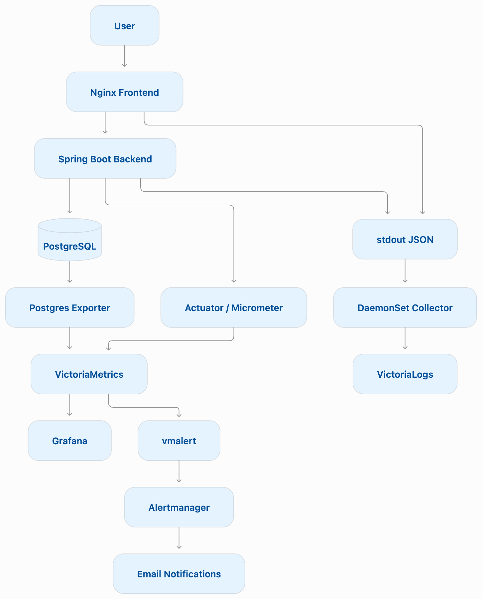

# Note Service

Клиент-серверное приложение для ведения личных заметок с инфраструктурой мониторинга и обеспечения надежности на базе Kubernetes.

Проект демонстрирует практическое применение DevOps и SRE-подходов: контейнеризацию, оркестрацию сервисов, централизованное логирование, сбор метрик, контроль доступности, алертинг и визуализацию состояния приложения.

## Архитектура проекта

Проект состоит из клиентского приложения, REST API, базы данных и инфраструктурных компонентов мониторинга.

### Основные компоненты

| Компонент | Технологии | Назначение |
|---|---|---|
| Backend | Java 22, Spring Boot 3.3.4 | REST API, бизнес-логика, аутентификация |
| Frontend | HTML, JavaScript, Nginx | Пользовательский интерфейс, проксирование API |
| Database | PostgreSQL 16 | Хранение пользователей и заметок |
| Контейнеризация | Docker, Docker Compose | Сборка и запуск сервисов |
| Оркестрация | Kubernetes (Minikube) | Развертывание и управление контейнерами |
| Сбор метрик | VictoriaMetrics, Micrometer, Spring Boot Actuator | Сбор и хранение метрик приложения |
| Сбор логов | VictoriaLogs | Централизованное хранение и анализ логов |
| Экспорт метрик БД | Postgres Exporter | Мониторинг PostgreSQL |
| Визуализация | Grafana | Дашборды и анализ состояния системы |
| Алертинг | vmalert, Alertmanager | Обнаружение проблем и доставка уведомлений |
| Проверка доступности | Python Prober | Периодическая проверка API |

### Архитектурная схема:

## Реализованный функционал

### 1. Развертывание и контейнеризация

- Контейнеризация backend и frontend с использованием Docker, multi-stage сборка backend.
- Подготовка Kubernetes-манифестов для развертывания приложения в Minikube.
- Использование Deployment для управления репликами backend, frontend и PostgreSQL.
- Настройка Service для внутреннего взаимодействия компонентов и внешнего доступа к frontend.
- Вынесение конфигурации в ConfigMap и секретов в Secret.
- Использование PersistentVolumeClaim для сохранения данных PostgreSQL при пересоздании Pod.
- Настройка RollingUpdate для stateless-сервисов.

Приложение адаптировано под принципы The Twelve-Factor App: конфигурация через переменные окружения, разделение сборки и выполнения, stateless-процессы, централизованное логирование и другие факторы.

Подробнее в `./Отчёт.md` и `./Отчет_2_kubernetes.md`

### 2. Централизованное логирование

Развернута VictoriaLogs (single-node) в отдельном Kubernetes namespace `logging`.

Реализована схема доставки логов:

`Application stdout → Kubernetes → DaemonSet Collector → VictoriaLogs`

- Настроено структурированное JSON-логирование backend с использованием LogstashEncoder.
- Настроен JSON access-log Nginx с выводом в stdout.
- Развернут DaemonSet-коллектор для сбора логов контейнеров со стороны Kubernetes-ноды.
- Добавлены Kubernetes-метаданные: namespace, pod_name, container_name и другие.
- Настроены LogsQL-запросы для фильтрации, группировки и агрегирования логов.

Реализованные сценарии анализа:
- просмотр логов за временной интервал;
- фильтрация по уровню логирования;
- группировка записей по уровням через `stats`;
- подсчет уникальных `traceId` и `request_id` через `count_uniq`;
- поиск наиболее частых сообщений через `top`.

Подробнее в `./Отчет_3_логи.md`

### 3. Мониторинг метрик

Развернута VictoriaMetrics (single-node) для централизованного хранения и анализа метрик.

Настроен сбор метрик по Pull-модели с использованием Prometheus Service Discovery и Kubernetes-аннотаций `prometheus.io/*`.

**Метрики приложения:**
- JVM и Spring Boot Actuator;
- HTTP-запросы и коды ответов;
- RPS и latency;
- использование Heap и работа Garbage Collector;
- состояние пула соединений HikariCP.

**Бизнес-метрики:**
- количество регистраций пользователей;
- количество запросов на получение заметок;
- количество успешно созданных заметок;
- количество обновлений и удалений заметок;
- количество неуспешных операций создания, обновления и удаления заметок.

Для реализации бизнес-метрик использованы Micrometer и собственные счетчики приложения.

**Мониторинг PostgreSQL:**
- развернут Postgres Exporter;
- настроен экспорт метрик PostgreSQL;
- подключен сбор метрик через VictoriaMetrics.

Подробнее в `./Отчет_4_метрики.md`

### 4. SLI / SLO / SLA и проверка доступности

Реализован Request-Based подход к оценке надежности приложения.

**SLI (Service Level Indicator)** — доля успешно выполненных бизнес-операций создания, обновления и удаления заметок относительно общего количества попыток.

Для расчета используются успешные и неуспешные операции за скользящее окно в 5 минут с применением PromQL-функции `increase()`.

**SLO (Service Level Objective):** целевой уровень успешности бизнес-операций — 99,9%.

**SLA (Service Level Agreement):** в рамках проекта сформулирован целевой уровень 99% успешных бизнес-операций за календарный месяц.

Дополнительно реализован Python Prober, который примерно каждые 30 секунд выполняет HTTP-запросы к API и проверяет доступность приложения.

Для проверки поведения системы при деградации реализован механизм искусственного внедрения ошибок с настраиваемой периодичностью через переменные окружения. Это позволяет воспроизводить сбои и наблюдать снижение SLI.

Подробнее в `./Отчет_5_sla.md`

### 5. Алертинг

Настроена система обнаружения проблем на базе vmalert и Alertmanager.

Реализованы правила оповещения:

**Бизнесовые метрики:**
- снижение Business SLI ниже 99%;
- отсутствие запросов на получение заметок в течение 30 минут.

**Метрики приложения и JVM:**
- доля HTTP 5xx превышает 5%;
- наличие ожидающих соединений в пуле HikariCP;
- использование JVM Heap превышает 85%;
- нагрузка Garbage Collector превышает 10%.

Настроена группировка уведомлений и отправка сообщений через SMTP на электронную почту при срабатывании и разрешении алертов.

Подробнее в `./Отчет_6_алерты.md`

### 6. Визуализация и Grafana Dashboard

Развернута Grafana и подключена VictoriaMetrics в качестве источника данных.

Разработан дашборд для комплексного мониторинга состояния приложения с использованием подходов RED, USE и Golden Signals.

**Панели дашборда:**
- Business SLI / SLA;
- HTTP Request Rate (RPS);
- HTTP Response Time (p95);
- HTTP 5xx Error Rate;
- JVM Heap Usage;
- CPU Usage;
- Container Memory Usage;
- PostgreSQL Availability (`pg_up`).

Дополнительно импортирован готовый дашборд PostgreSQL Exporter для детализации состояния базы данных.

Подробнее в `./Отчет_7_grafana.md`

## Технологический стек

**Backend:** Java 22, Spring Boot, Spring Security, Spring Data JPA, Hibernate, Liquibase.

**Database:** PostgreSQL 16.

**Infrastructure:** Docker, Docker Compose, Kubernetes, Minikube, Nginx.

**Monitoring & Observability:** VictoriaMetrics, VictoriaLogs, Grafana, Micrometer, Spring Boot Actuator, Postgres Exporter.

**Alerting:** vmalert, Alertmanager.

**Additional:** Python, Bash, PromQL, LogsQL, Maven, Git, Helm.

## Результат

В рамках проекта реализован полный цикл наблюдаемости приложения: от сбора технических и бизнесовых метрик и централизованного логирования до контроля SLI/SLO, автоматического обнаружения деградации и визуализации состояния системы.

Проект позволил практически изучить Kubernetes, мониторинг распределенных компонентов, эксплуатацию PostgreSQL, диагностику проблем приложения и применение SRE-подходов к обеспечению надежности сервисов.