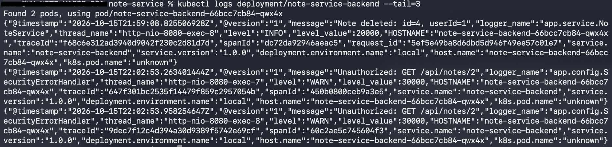
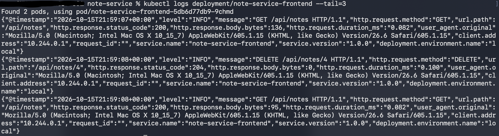
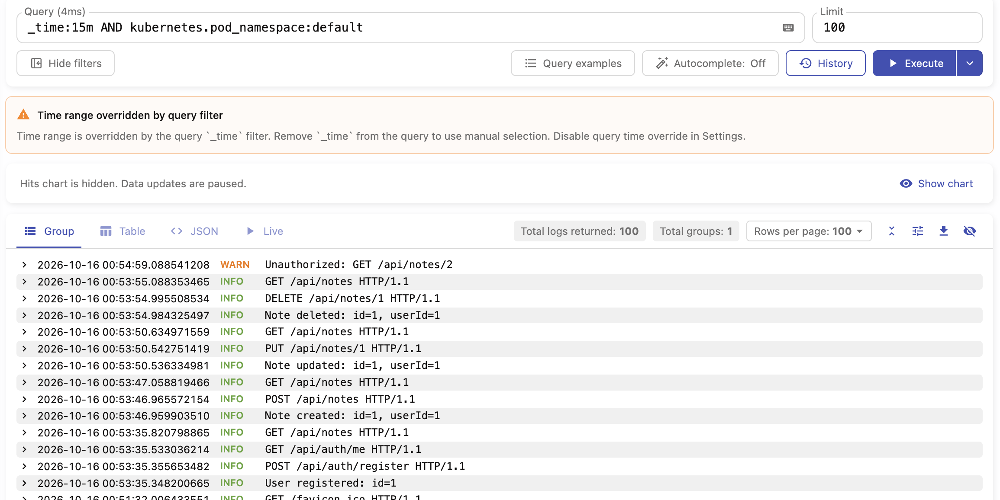
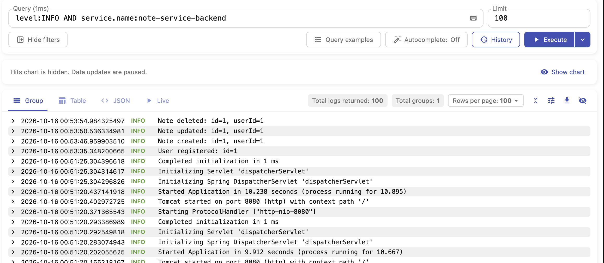
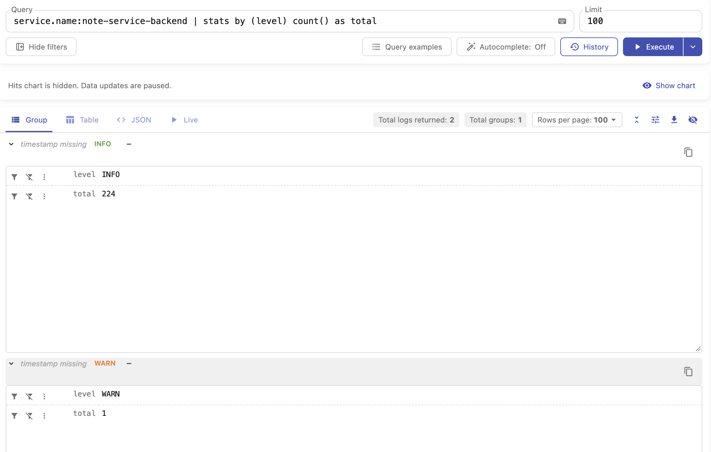
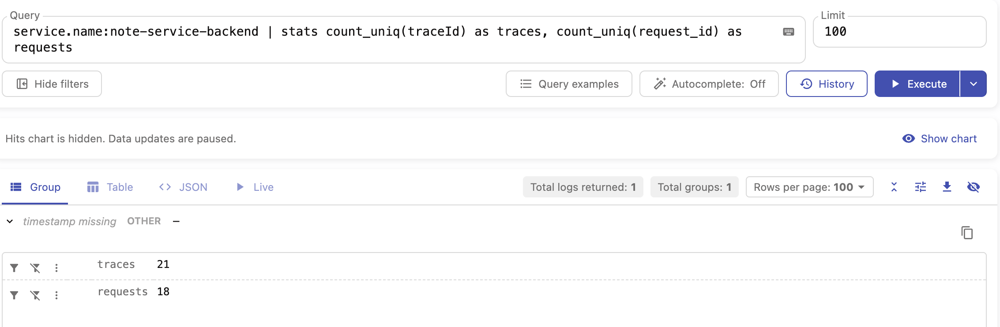
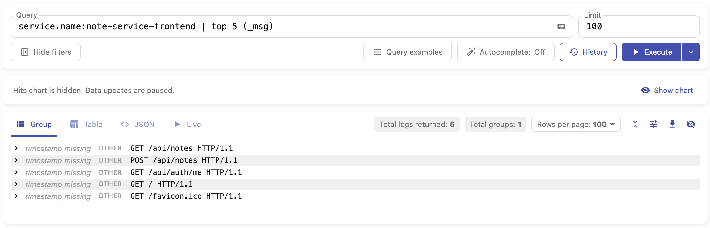

Доставка логов

Логи собираются по схеме stdout → коллектор → Victoria Logs:

+ Приложения пишут логи в stdout в формате JSON. Бэкенд использует LogstashEncoder, фронтенд (nginx) переводится на JSON-формат access-лога с выводом в /dev/stdout.
+ Kubernetes сохраняет stdout каждого контейнера на ноде. Коллектор (<имя коллектора>) запущен как DaemonSet: по одному поду на каждой ноде. Он читает эти файлы, добавляет метаданные Kubernetes (kubernetes.pod_name, kubernetes.pod_namespace, kubernetes.container_name и др.) и отправляет записи в Victoria Logs.
+ Victoria Logs (single-node, отдельный namespace logging) хранит записи и отвечает на запросы LogsQL.

Логи бэка:

Логи фронта:

LogsQL-запросы: 
1. Сырые записи за последние 15 минут

Фильтр _time:15m ограничивает выборку последними 15 минутами, kubernetes.pod_namespace:default оставляет только свои поды, без системных
2. Фильтр по полю

Запрос возвращает логи только уровня INFO
3. stats-запрос с группировкой

Считает строки бэкенда по уровням логирования. Результат: строка на каждый уровень (INFO, WARN, ERROR) с колонкой total.
4. Агрегирующий запрос с count_uniq

Запрос берёт все строки логов, где service.name равен note-service-backend, и считает две величины:
+ count_uniq(traceId) — сколько уникальных значений traceId встретилось. Один traceId соответствует одному запросу в распределённом трейсе, поэтому это примерно число разных запросов, которые прошли через бэкенд.
+ count_uniq(request_id) — сколько уникальных request_id, то есть сколько HTTP-запросов обработал бэкенд.

request_id и traceId не соответствуют из-за строк без request_id (запросы вне фильтра, probe, старт приложения)

5. Агрегирующий запрос с top 

Запрос отбирает строки фронтенда, где service.name равен note-service-frontend, и выводит 5 самых частых значений поля _msg.
