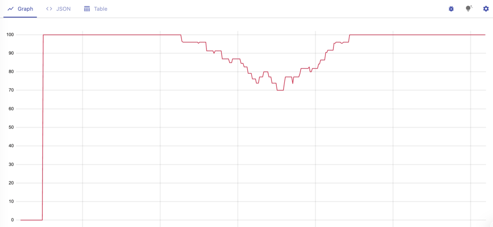

## Домашнее задание №5. SLA

### 1. Описание выбранных метрик

Для оценки надёжности приложения выбраны бизнес-метрики, отражающие результаты выполнения основных операций над заметками.

#### 1.1. Метрики создания заметок

| Метрика | Тип | Описание |
|---|---|---|
| `notes_total` | Counter | Общее количество успешно созданных заметок |
| `notes_create_failures_total` | Counter | Общее количество неуспешных операций создания заметок |


#### 1.2. Метрики обновления заметок

| Метрика | Тип | Описание |
|---|---|---|
| `notes_updated_total` | Counter | Общее количество успешно обновлённых заметок |
| `notes_update_failures_total` | Counter | Общее количество неуспешных операций обновления заметок |


#### 1.3. Метрики удаления заметок

| Метрика | Тип | Описание |
|---|---|---|
| `notes_deleted_total` | Counter | Общее количество успешно удалённых заметок |
| `notes_delete_failures_total` | Counter | Общее количество неуспешных операций удаления заметок |


### 2. Формулировки SLI, SLO и SLA

#### 2.1. SLI (Service Level Indicator)

В рамках проекта используется Request-Based SLI (показатель на основе запросов). Он рассчитывается как отношение количества успешно выполненных бизнес-операций к общему количеству выполненных операций.

Для расчёта учитываются три основных вида операций:
- создание заметки;
- обновление заметки;
- удаление заметки.

Общая формула:

\[
SLI = \frac{N_{success}}{N_{success}+N_{failure}}\times100\%
\]

где:

- \(N_{success}\) — количество успешно выполненных операций;
- \(N_{failure}\) — количество неуспешных операций.

Для общего SLI приложения используется сумма успешных и неуспешных операций всех трёх типов.

Формула общего показателя:

\[
SLI_{total} =
\frac{
N_{create}^{success}+
N_{update}^{success}+
N_{delete}^{success}
}{
N_{all}^{success}+N_{all}^{failure}
}
\times100\%
\]

В проекте для расчёта используется скользящее временное окно продолжительностью 5 минут. Для получения количества новых операций за выбранный период применяется функция `increase()` языка PromQL.

Пример запроса для общего SLI:

```promql
100 *
(
  (sum(increase(notes_created_total[5m])) or vector(0))
  +
  (sum(increase(notes_updated_total[5m])) or vector(0))
  +
  (sum(increase(notes_deleted_total[5m])) or vector(0))
)
/
clamp_min(
  (sum(increase(notes_created_total[5m])) or vector(0))
  +
  (sum(increase(notes_updated_total[5m])) or vector(0))
  +
  (sum(increase(notes_deleted_total[5m])) or vector(0))
  +
  (sum(increase(notes_create_failures_total[5m])) or vector(0))
  +
  (sum(increase(notes_update_failures_total[5m])) or vector(0))
  +
  (sum(increase(notes_delete_failures_total[5m])) or vector(0)),
  1
)
```



Использование `sum()` позволяет агрегировать значения метрик всех реплик backend-приложения.

Функция `increase()` рассчитывает прирост счётчика за последние 5 минут, а `or vector(0)` позволяет учитывать метрики, которые ещё не были зарегистрированы вследствие отсутствия соответствующих ошибок или успешных операций.

Отдельно рассчитываются SLI для каждой операции: создания, обновления и удаления заметок. Это позволяет определить, какая именно функциональность приложения работает нестабильно.

#### 2.2. SLO (Service Level Objective)


Для Note Service в качестве целевого значения можно установить:

**SLO: не менее 99,9% успешно выполненных бизнес-операций за скользящий период наблюдения.**

Формулировка:

> Не менее 99,9% операций создания, обновления и удаления заметок должны завершаться успешно в течение выбранного периода оценки.

Для оценки достижения SLO используется сравнение фактического значения SLI с установленным целевым значением:

\[
SLI \geq SLO
\]


#### 2.3. SLA (Service Level Agreement)

- SLO: 99,9% успешных бизнес-операций за отчётный период. Целевое значение индикатора, к которому стремится команда
- SLA: 99% успешных бизнес-операций за календарный месяц. Внешнее соглашение с бизнесом или клиентами об уровне сервиса
- SLI: фактическая доля успешно выполненных бизнес-операций.

В эксперименте искусственно внедрялись ошибки выполнения операций. При увеличении частоты отказов SLI снижался вплоть до 70%, что демонстрирует нарушение заданных целевых показателей.

### 3. Изменения приложения для демонстрации SLI

Для демонстрации влияния ошибок на надёжность приложения в Note Service был реализован механизм искусственного внедрения сбоев.

#### 3.1. Реализация счётчиков бизнес-операций

При возникновении искусственной ошибки увеличивается счётчик неуспешных операций:

```java
meterRegistry.counter("notes.create.failures").increment();
meterRegistry.counter("notes.update.failures").increment();
meterRegistry.counter("notes.delete.failures").increment();
```

Счётчики размещены в `NoteService`

#### 3.2. Механизм искусственного внедрения ошибок

Для демонстрации изменения SLI реализована возможность принудительно вызывать ошибки с заданной периодичностью.

Периодичность задаётся через переменные окружения:

| Переменная | Назначение |
|---|---|
| `DEMO_FAILURE_CREATE_EVERY` | Частота искусственных ошибок при создании заметок |
| `DEMO_FAILURE_UPDATE_EVERY` | Частота искусственных ошибок при обновлении заметок |
| `DEMO_FAILURE_DELETE_EVERY` | Частота искусственных ошибок при удалении заметок |

Например, следующая конфигурация:

```bash
DEMO_FAILURE_CREATE_EVERY=3
DEMO_FAILURE_UPDATE_EVERY=5
DEMO_FAILURE_DELETE_EVERY=4
```

означает, что:
- каждая третья операция создания завершится искусственной ошибкой;
- каждая пятая операция обновления завершится искусственной ошибкой;
- каждая четвёртая операция удаления завершится искусственной ошибкой.

Для реализации периодичности используются отдельные счётчики `AtomicInteger`. При достижении заданного количества операций приложение увеличивает соответствующий счётчик ошибок и возвращает HTTP 500.

Такой механизм позволяет воспроизводить ухудшение качества обслуживания без необходимости изменять бизнес-логику или намеренно нарушать работу базы данных.

### 4. Prober

Для дополнительной проверки работоспособности приложения используется Python Prober — отдельный компонент, выполняющий периодические проверки API Note Service.

Prober выступает в роли внешнего проверяющего компонента. Он имитирует действия пользователя, отправляя HTTP-запросы к API и анализируя полученные ответы. Проверки выполняются с определённой периодичностью (примерно раз в 30 секунд).
