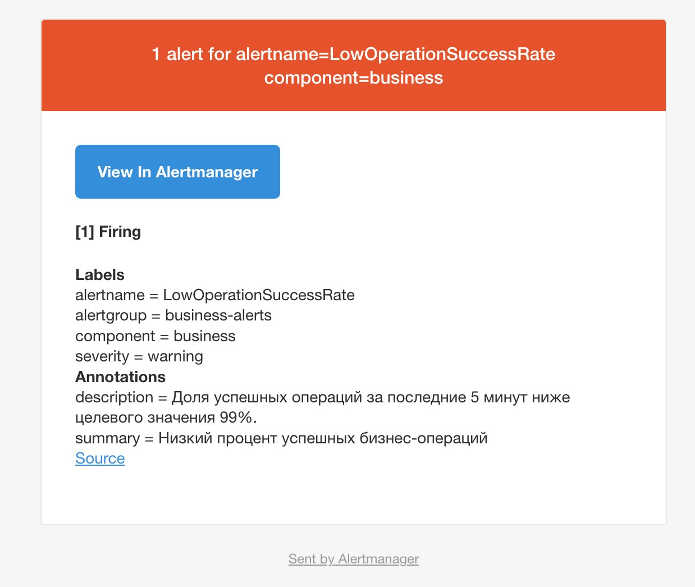
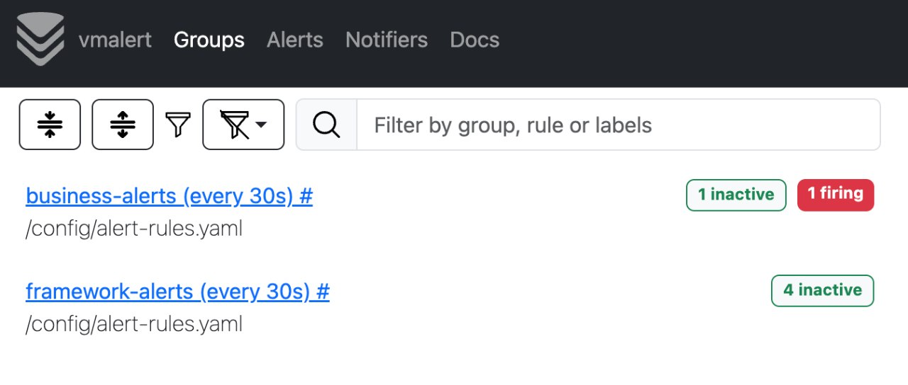
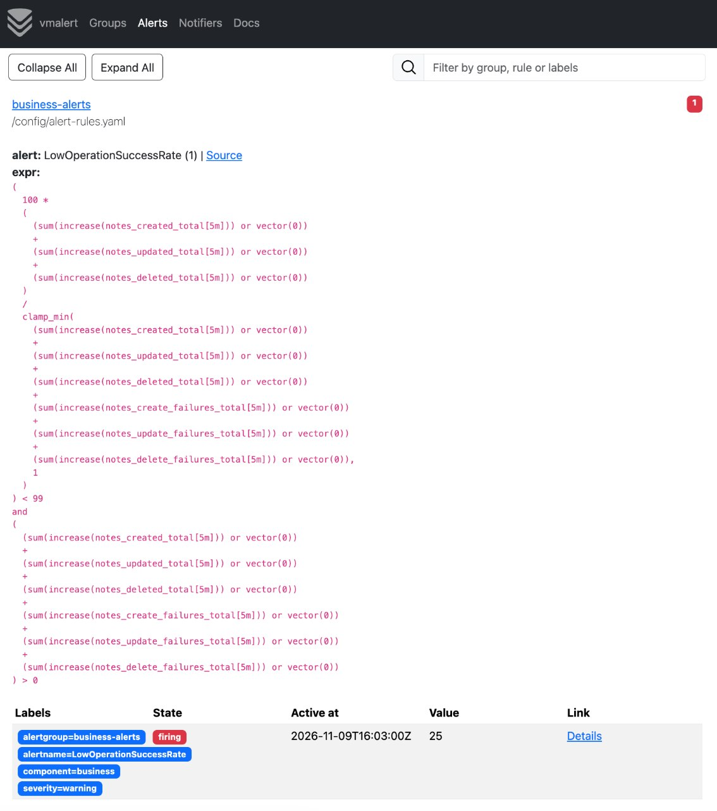

## Домашнее задание №6. Алерты

### Выбранные метрики и условия срабатывания алертов

Для мониторинга сервиса были выбраны бизнесовые метрики, а также метрики Spring Boot и JVM. Условия срабатывания алертов подобраны таким образом, чтобы выявлять снижение успешности бизнес-операций и возможные проблемы в работе приложения.

**Бизнесовые метрики сервиса:**

1. **Снижение Business SLI ниже 99%.** Рассчитывается доля успешно выполненных операций создания, обновления и удаления заметок за последние 5 минут. Алерт срабатывает, если показатель опускается ниже 99% в течение 2 минут. Условие позволяет обнаружить увеличение количества неуспешных бизнес-операций и своевременно выявить деградацию сервиса.

2. **Отсутствие запросов на получение заметок в течение 30 минут.** Алерт позволяет обнаружить отсутствие активности при чтении данных. Это может указывать на проблемы с доступностью соответствующей функциональности или на снижение пользовательской активности.

**Метрики приложения, фреймворка и JVM:**

1. **Доля HTTP 500-ошибок превышает 5%.** Рассчитывается процент запросов с HTTP-статусом 5xx от общего количества запросов за последние 5 минут. Алерт срабатывает, если доля ошибок превышает 5% в течение 2 минут. Позволяет выявлять серверные ошибки и проблемы при обработке HTTP-запросов.

2. **Ожидание свободных соединений с базой данных.** Алерт срабатывает, если количество ожидающих соединения HikariCP превышает 0 в течение 1 минуты. Позволяет обнаружить нехватку доступных соединений в пуле и потенциальные проблемы с производительностью взаимодействия с БД.

3. **Использование JVM Heap превышает 85%.** Алерт срабатывает при сохранении высокого уровня использования Heap в течение 5 минут. Позволяет своевременно обнаружить повышенное потребление памяти и предотвратить возможные ошибки `OutOfMemoryError`.

4. **Нагрузка Garbage Collector превышает 10%.** Алерт срабатывает, если JVM тратит более 10% времени на сборку мусора в течение 5 минут. Высокое значение показателя может свидетельствовать об интенсивном создании объектов, недостатке доступной памяти или чрезмерной нагрузке на сборщик мусора.

### Способ доставки алертов

Для доставки уведомлений используется связка VictoriaMetrics Alert (vmalert) и Alertmanager. При выполнении условий срабатывания vmalert передаёт алерты в Alertmanager, который группирует уведомления и отправляет их на указанную электронную почту через SMTP-сервер Яндекса. Также настроена отправка уведомлений как при срабатывании алерта, так и при его разрешении.

**Ниже представлен скриншот уведомления алерта**

**Скриншоты из vmalert:**

