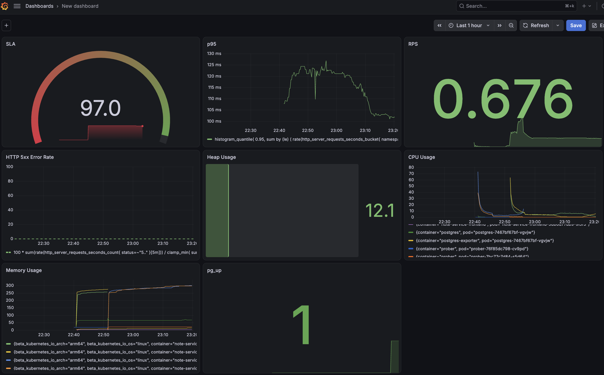
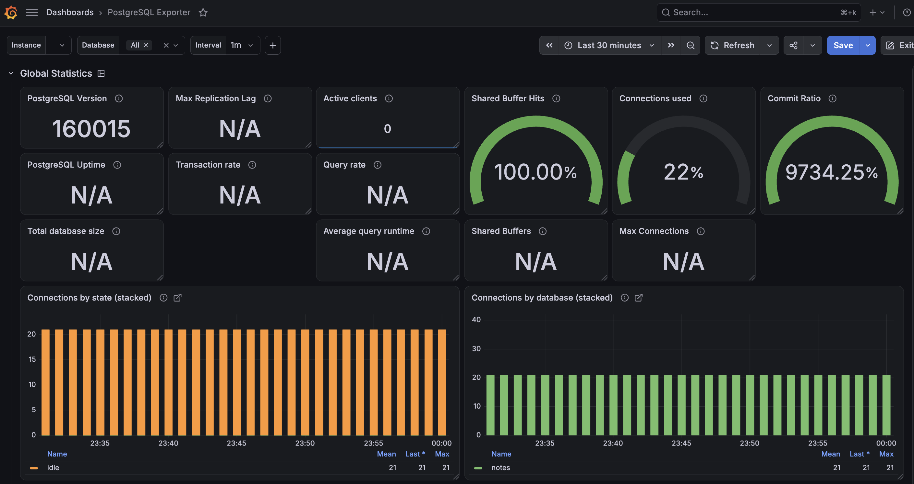
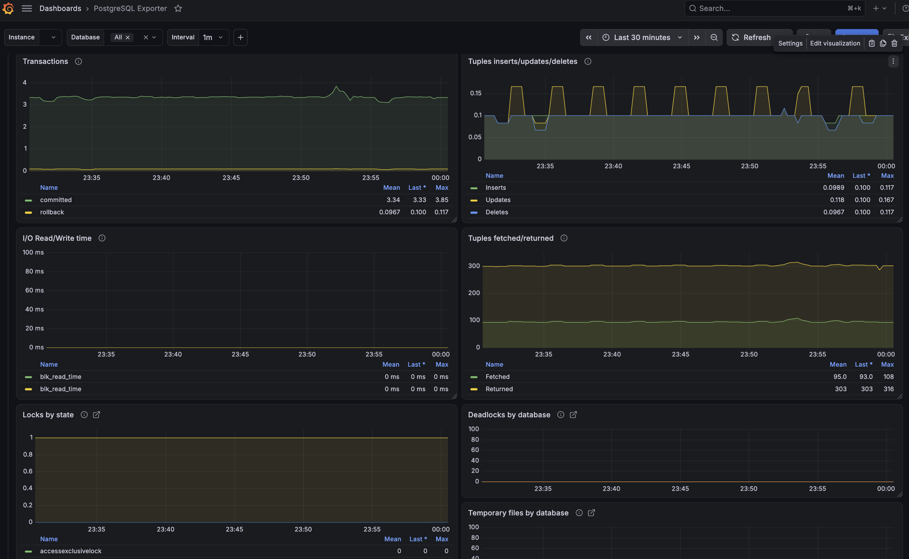

## Домашнее задание №7. Grafana

### Метрики дашборда

**1. SLA**

Метрика: доля успешно выполненных бизнес-операций относительно общего количества попыток.

SLI (Service Level Indicator) используется для количественной оценки качества предоставляемого сервисом функционала.

В рамках проекта успешность оценивается на основе результатов выполнения операций создания, обновления и удаления заметок. Метрика позволяет отслеживать долю успешных операций и выявлять ухудшение качества работы приложения.

**2. HTTP Request Rate (RPS)**

Метрика: количество HTTP-запросов в секунду.

Панель отображает интенсивность поступающих запросов к backend-приложению. Позволяет оценивать текущую нагрузку, выявлять периоды повышенной активности и анализировать изменение пользовательского трафика.

Выбор данной метрики обусловлен необходимостью понимать, насколько интенсивно используется приложение и как меняется нагрузка во времени.

**3. HTTP Response Time (p95)**

Метрика: 95-й перцентиль времени обработки HTTP-запросов (`p95`).

Панель отображает время обработки запросов, ниже которого завершаются 95% всех запросов за выбранный временной интервал. Оставшиеся 5% запросов выполняются дольше.

В отличие от среднего времени ответа, p95 позволяет выявлять проблемы с медленными запросами, которые могут теряться при усреднении показателей. Например, среднее время ответа может оставаться низким, даже если небольшая часть пользователей сталкивается с существенными задержками.

Метрика используется для контроля производительности приложения, обнаружения деградации времени ответа и оценки пользовательского опыта. Особенно полезна при увеличении нагрузки на приложение.

**4. HTTP 5xx Error Rate**

Метрика: процент серверных ошибок относительно общего количества запросов.

Панель позволяет отслеживать долю запросов, завершившихся ошибками на стороне сервера. Рост значения может свидетельствовать о проблемах в бизнес-логике приложения, взаимодействии с базой данных или нехватке ресурсов.

Метрика важна для оценки надёжности приложения и контроля соблюдения целевых показателей доступности.

**5. Heap usage**

Метрика: объём используемой heap-памяти относительно максимального доступного объёма.

Панель позволяет контролировать потребление памяти Java-приложением и выявлять тенденции к её чрезмерному использованию.

Устойчивый рост потребления heap-памяти может свидетельствовать о повышенной нагрузке или возможных утечках памяти.

**6. CPU Usage**

Метрика: использование процессорного времени контейнерами.

Панель позволяет отслеживать потребление CPU backend-, frontend- и других контейнеров. Используется для выявления повышенной нагрузки и определения компонентов, потребляющих наибольшее количество вычислительных ресурсов.

**7. Memory Usage**

Метрика: объём используемой памяти контейнерами.

Позволяет контролировать потребление оперативной памяти и выявлять контейнеры с повышенным расходом ресурсов.

**8. PostgreSQL Availability**

Метрика: pg_up.

Отображает доступность PostgreSQL для экспортера. Значение 1 означает успешное подключение, значение 0 — ошибку подключения.

Используется для оперативного обнаружения проблем с доступностью базы данных.

### Импортированный дашборд PostgresSQL Exporter

